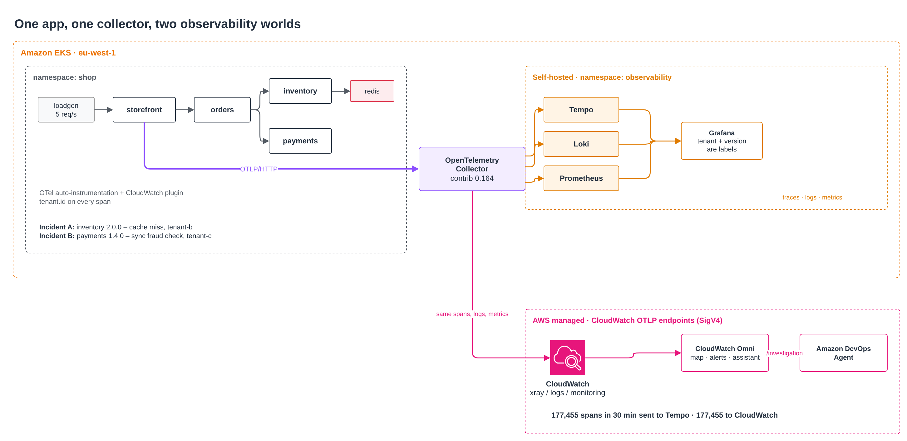

# CloudWatch Omni vs a self-hosted Grafana stack

One app, one OpenTelemetry Collector, two observability worlds. The same telemetry goes to **Amazon CloudWatch Omni** and to a self-hosted **Tempo + Loki + Prometheus + Grafana** stack on Amazon EKS. Then you ship a broken release and investigate it on both sides.

Companion code for the article *"I Gave the Same Incident to CloudWatch Omni and to My Grafana Stack"* on AWS Builder Center.



## What's inside

| Path | What |
|---|---|
| `app/` | Four Flask services and a load generator. Every request carries a tenant (`X-Tenant` → `tenant.id` on the span). |
| `k8s/10-collector.yaml` | The collector: every signal exported twice, to the Grafana stack and to the CloudWatch OTLP endpoints. |
| `k8s/20-grafana-stack.yaml` | Tempo, Loki, Prometheus (with alert rules) and Grafana with provisioned data sources. Single binaries, `emptyDir` storage: a lab, not production. |
| `k8s/30-shop.yaml` | The shop. Uses `python:3.12-slim` and installs packages at start-up, so there is no image to build. |
| `grafana/shop-dashboard.json` | RED per service, error rate per tenant, p95 per tenant and version, collector export failures, warnings from Loki. |
| `incident/` | Start, stop and time-stamp the incidents. |
| `scripts/` | Everything you run from AWS CloudShell, in order. |
| `EXPERIMENT.md` | The measurement protocol: data checks, alerts, timelines, scoring. |

## The incidents

| | Release | What breaks | Who suffers |
|---|---|---|---|
| **A** | inventory 2.0.0 | The new price-rule cache reads one key and writes another. Every read misses and triggers 40 slow lookups. | tenant-b: ~1 s per request, 504s from the 800 ms timeout in orders |
| **B** | payments 1.4.0 | A synchronous fraud check for tenant-c takes 0.3–2.6 s. orders gives up after 2 s. | tenant-c: about a quarter of checkouts fail |

A red herring is always on: payments logs `card network latency high, retrying` before, during and after both incidents.

## Prerequisites

- An AWS account where you may create an EKS cluster, IAM roles and CloudWatch resources.
- A Region where CloudWatch Omni is available. The scripts default to `eu-west-1`.
- AWS CloudShell in that Region. `kubectl` and the AWS CLI are already there; the scripts install `eksctl`.
- Your laptop's public IP (https://checkip.amazonaws.com). Grafana is only reachable from it.

## Run it

Open AWS CloudShell in your Region, then:

```bash
git clone https://github.com/romanceresnak/omni-vs-grafana-lab && cd omni-vs-grafana-lab
chmod +x scripts/*.sh incident/*.sh
echo <YOUR-LAPTOP-PUBLIC-IP> > ~/.omni-lab-ip
source env.sh               # REGION, CLUSTER, LOG_GROUP, ACCOUNT_ID, MY_IP
./scripts/01-tools.sh       # eksctl into ~/bin
./scripts/02-cluster.sh     # EKS + IAM role for the collector (IRSA), ~20 min
./scripts/03-aws.sh         # log group + log stream, Transaction Search check
```

Now set up CloudWatch Omni in the console (`EXPERIMENT.md`, step 0) and make sure **OTel span ingestion** is on. Run `./scripts/03-aws.sh` again until Transaction Search shows `CloudWatchLogs` / `ACTIVE`. Then:

```bash
./scripts/04-deploy.sh      # Grafana stack + collector + shop; prints Grafana URL and password
./scripts/05-verify.sh      # after ~5 min: both worlds must show [OK]
```

Break it, then fix it:

```bash
./incident/start.sh a          # or b, or blind
./incident/mark.sh "omni: alert critical"
./incident/stop.sh
./incident/timeline-auto.sh    # Grafana alert timeline from Prometheus
```

Clean up:

```bash
./scripts/99-destroy.sh
```

Then, in the console: delete the Omni space and domain, delete the DevOps Agent space, and turn off Transaction Search if you don't need it.

## Things that will bite you

- **The CloudWatch OTLP logs endpoint does not create the log stream** named in `x-aws-log-stream`. Without it you get HTTP 400 "The specified log stream does not exist", visible only in the collector's log. `03-aws.sh` creates it.
- **No spans in CloudWatch without Transaction Search** set to `CloudWatchLogs` / `ACTIVE`.
- **Omni PromQL:** resource attributes have an `@resource.` prefix (`"@resource.service.name"="storefront"`), and dotted names need quotes (`{"traces.span.metrics.calls"}`).
- **The CloudWatch plugin's RED metrics don't carry custom span attributes** such as `tenant.id`. Per-tenant alerts only work on the Grafana side.
- **CloudShell disconnects after ~20 minutes of inactivity** and its credentials can expire during long `eksctl` runs. Re-run `cd omni-vs-grafana-lab && source env.sh`; for `eksctl`, see the comment in `scripts/99-destroy.sh`.
- **New CloudShell session?** Always `cd omni-vs-grafana-lab && source env.sh` first.

## Cost

While it runs: EKS control plane, 2 × t3.large, a NAT gateway and a Classic Load Balancer, roughly USD 0.40 per hour in eu-west-1, plus CloudWatch ingestion. CloudWatch Omni offers a trial credit for OpenTelemetry telemetry, and Amazon DevOps Agent ($0.0083 per agent-second) a free trial for new customers; check your eligibility in the console. **Run `99-destroy.sh` when you're done.**

## License

MIT
